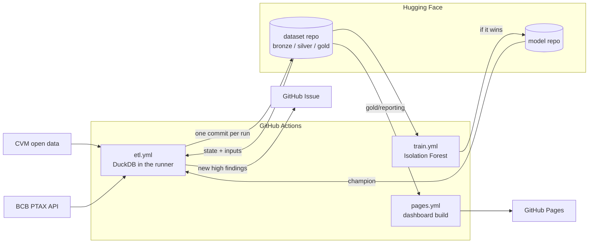

# cvm-fundwatch

A zero cost data pipeline for Brazilian investment fund data. It runs entirely on GitHub
Actions, builds a bronze/silver/gold lake of Parquet files on Hugging Face, detects anomalies in
the daily fund reports, and publishes a static dashboard on GitHub Pages.

- **Sources**: CVM daily reports of every investment fund since 2000 (today about 25,000
  classes and 500,000 rows a month), the CVM fund registry, and the BCB PTAX dollar rate.
- **Lake**: Parquet on a Hugging Face dataset repo, one atomic commit per run, queryable from the
  Hugging Face Data Studio, DuckDB or Polars.
- **Anomaly detection**: rules, robust statistics, an accounting identity check, peer context
  and an Isolation Forest, evaluated with injected errors. Market wide moves are not flagged.
- **Dashboard**: `https://dbconsultoria.github.io/cvm-fundwatch/` (after the first prod run).

No servers, no databases, no credit card.

## Architecture



Every run: read the state (`_manifest.json`) and the partitions of its window from Hugging Face,
download only source files that changed, rebuild the layers in DuckDB inside the runner, run
quality checks, and push everything in one commit. A failed check publishes nothing. Details,
diagrams and the code map: [docs/architecture.md](docs/architecture.md).

| Layer | Tables | Grain |
|---|---|---|
| bronze | `cvm_inf_diario`, `cvm_registry/<table>`, `bcb_ptax` | source rows as strings, plus source metadata |
| silver | `fund_daily`, `fund_registry`, `ptax_daily` | typed, one schema across the three CVM layouts, deduplicated |
| gold | `daily_flows`, `returns_brl_usd`, `anomalies`, `restatements` | business tables, partitioned `ano_mes=YYYYMM` |
| gold | `reporting/*` | small aggregates for the dashboard |

| Workflow | When | What |
|---|---|---|
| `ci.yml` | push, pull request | ruff, the offline test suite, dashboard build from demo data |
| `etl.yml` | Mon to Sat 17:23 UTC, manual | pipeline for dev and prod; 13 month lookback on Saturdays |
| `train.yml` | Sundays 06:17 UTC, manual | trains the Isolation Forest, publishes it only if it beats the current one |
| `pages.yml` | after each ETL on `main`, manual | builds and deploys the dashboard |
| `keepalive.yml` | monthly | keeps the schedules enabled |

## Run it on GitHub

Everything below is done once in the Hugging Face and GitHub web interfaces. `<owner>` is your
Hugging Face user or organization; `<github user>` is the GitHub account that owns the repo.

### 1. Hugging Face: repos and tokens

1. Create four repositories (New, then Dataset or Model). The names are fixed by
   `config/pipeline.yml`; the pipeline refuses to run if a visibility is wrong.

   | Repository | Type | Visibility |
   |---|---|---|
   | `<owner>/cvm-fundos-lake-dev` | Dataset | private |
   | `<owner>/cvm-fundos-lake` | Dataset | public |
   | `<owner>/cvm-fundos-anomaly-dev` | Model | private |
   | `<owner>/cvm-fundos-anomaly` | Model | public |

2. Create four **fine grained** tokens (Settings, Access Tokens, Create new token,
   Fine-grained). Under "Repositories permissions" select only the repos listed, tick the
   access listed, leave everything else unticked. Copy each token when it is shown.

   | Token | Write access | Read access |
   |---|---|---|
   | `cvm-fundwatch-dev` | `cvm-fundos-lake-dev` | |
   | `cvm-fundwatch-prod` | `cvm-fundos-lake` | |
   | `cvm-fundwatch-model-dev` | `cvm-fundos-anomaly-dev` | `cvm-fundos-lake-dev` |
   | `cvm-fundwatch-model-prod` | `cvm-fundos-anomaly` | `cvm-fundos-lake` |

### 2. GitHub: repository settings

In the GitHub repository (create it as **public** if it does not exist yet):

1. **Settings, Actions, General**, Workflow permissions: "Read repository contents and packages
   permissions". Leave "Allow GitHub Actions to create and approve pull requests" unticked.
2. **Settings, Secrets and variables, Actions, Variables**: repository variable
   `HF_OWNER` = `<owner>`.
3. **Settings, Pages**, Build and deployment, Source: **GitHub Actions**.
4. **Settings, Environments**, create three environments:

   | Environment | Deployment branches | Required reviewers | Secrets | Variable |
   |---|---|---|---|---|
   | `dev` | selected: `main`, `development` | none | `HF_TOKEN` = dev token, `HF_MODEL_TOKEN` = model dev token | `CVM_LAKE_ENV` = `dev` |
   | `prod` | selected: `main` | none | `HF_TOKEN` = prod token, `HF_MODEL_TOKEN` = model prod token | `CVM_LAKE_ENV` = `prod` |
   | `prod-approval` | selected: `main` | yourself | none | none |

   `dev` allows `main` because scheduled workflows always start from the default branch; the
   dev job then checks out `development`. Reviewers sit on `prod-approval`, not on `prod`, so
   the daily prod run is not blocked while manual writes to prod still need an approval.

### 3. Push the code

Once step 2 is done (otherwise the first scheduled runs fail at the guard):

```bash
git push -u origin main
git push origin main:development
```

Then **Settings, Rules, Rulesets**, a branch ruleset for `main`: require a pull request before
merging, require the status checks `test` and `dashboard` (they appear after the first CI run),
block force pushes, restrict deletions. Optionally a lighter one for `development` (require
`test`, block force pushes). After the first Pages deployment, restrict the `github-pages`
environment to `main` too.

### 4. First dev runs

Actions, **etl**, Run workflow:

1. Branch `development`, environment `dev`, **dry run ticked**. Read the job summary (bronze
   status, rows per month, anomalies, quality) and download the `lake-dev-...` artifact if you
   want to look at the files.
2. Same with **dry run unticked**. The dev dataset gets its first commit; open it on Hugging Face
   and check the dataset viewer shows `daily_flows`.
3. Backfill dev with about a year, e.g. `months` = `202501-202512`, dry run unticked. This gives
   the anomaly layers their history and the forest something to train on.

### 5. Promote to prod

1. Open a pull request from `development` to `main`; merge when CI is green.
2. Actions, etl, Run workflow, branch `main`, environment `prod`, dry run ticked, then unticked.
   The unticked run waits for your approval in `prod-approval`.
3. Backfill prod **oldest first**, one dispatch per range of **at most 36 months** (the job has a
   2 hour limit and a month takes about 1 to 1.5 minutes): `200001-200212`, `200301-200512`, ...,
   up to the current year. Each range is committed in 12 month chunks. Order matters: the first
   month of a range reads the previous month's silver, published by the previous range.
4. The first prod ETL triggers **pages**; the dashboard appears at
   `https://<github user>.github.io/cvm-fundwatch/`.

### 6. Train the Isolation Forest

Once an environment has at least 10 months of history (6 training months, 3 history months, the
evaluation month): Actions, **train**, Run workflow, environment `dev`, then `prod` (prod waits
for approval before publishing). The job summary shows the model card: average precision,
recall, precision and alarm rate against the current model. Until a model exists the forest
layer is simply off.

### 7. Day to day

Nothing to do. The ETL runs Monday to Saturday at 17:23 UTC (after the CVM refresh and the PTAX
publication), training on Sundays, the dashboard after each ETL. What to look at:

| Signal | Meaning | Action |
|---|---|---|
| green run | published | none |
| yellow run (warnings) | a source was down, or a soft check warned | none; the next run catches up |
| red run, quality failed | a blocking check failed; nothing was published | read the step summary; rerun with dry run to inspect the artifact |
| red run, guard (exit 2) | a variable, secret, token scope or repo visibility is wrong | fix the setting named in the log |
| red run, commit failed | something else wrote to the repo during the run | rerun |
| Issue `[prod] High severity anomalies YYYY-MM` | new high findings (at most 20 per date) | read; details in `gold/anomalies` |
| schedule stopped | GitHub disables schedules after 60 days without activity | `keepalive` re-enables them monthly; or enable `etl` in the Actions tab |

Manual runs default to a dry run. A backfill is a manual run with `months`; a rerun of the
same months is safe (idempotent).

## Run locally

Requires [uv](https://docs.astral.sh/uv/) (and Node 20+ for the dashboard).

```bash
uv sync
uv run pytest            # offline: network access is blocked in tests
uv run ruff check .
```

```bash
# current and previous month into data/lake (git ignored)
uv run cvm-lake run --env dev

# a backfill; months before 2021 come from the CVM yearly archives
uv run cvm-lake run --env dev --months 202301-202312

# rebuild silver, gold, anomalies and reporting from local bronze, no downloads
uv run cvm-lake run --env dev --months 202310 --no-extract

# against the dev Hugging Face repo, without publishing
HF_OWNER=<owner> HF_TOKEN=<dev token> uv run cvm-lake run --env dev --target hf --out data/hf-dev --dry-run
```

The run prints a report per layer and exits with 1 when a blocking quality check fails.
`data/lake/_manifest.json` holds the state: unchanged source files are not downloaded again.

Dashboard: see [dashboard/README.md](dashboard/README.md).

## Query the lake

Every table of the public dataset can be queried without cloning anything.

**Hugging Face Data Studio** (SQL console): open `huggingface.co/datasets/<owner>/cvm-fundos-lake`,
pick a config (`daily_flows`, `returns_brl_usd`, `anomalies`, `restatements`, `fund_daily`,
`fund_registry`, `ptax_daily`) and query it in the browser.

**DuckDB**:

```sql
CREATE SECRET hf (TYPE huggingface, TOKEN 'hf_...');  -- any read token

-- assets under management per peer group on the last day of 2025
SELECT peer_group, round(sum(aum) / 1e9, 1) AS aum_brl_bn
FROM read_parquet('hf://datasets/<owner>/cvm-fundos-lake/gold/daily_flows/*/*.parquet',
                  hive_partitioning = true)
WHERE dt = DATE '2025-12-30' AND NOT coalesce(is_fic, false)
GROUP BY ALL ORDER BY 2 DESC;

-- high severity anomalies of a month
SELECT dt, fund_id, anomaly_type, score
FROM 'hf://datasets/<owner>/cvm-fundos-lake/gold/anomalies/ano_mes=202610/part-0.parquet'
WHERE severity = 'high' ORDER BY score DESC LIMIT 20;

-- a partition as it was at an earlier commit (commit ids are in _manifest.json)
SELECT count(*) FROM 'hf://datasets/<owner>/cvm-fundos-lake@<commit>/silver/fund_daily/ano_mes=202609/part-0.parquet';
```

**DBeaver** (or any DuckDB client): build a local DuckDB file with one view per table, then
open it as a DuckDB connection. The file holds view definitions only (no data, no token) and
is git ignored; rerun the script to pick up tables added since.

```bash
uv run python scripts/make_duckdb.py   # prod lake -> database/cvm_lake.duckdb
```

In DBeaver: New Database Connection, DuckDB, Path `database/cvm_lake.duckdb`. The schemas
`silver`, `gold` and `reporting` show up as tables. Filter by `ano_mes` on large views; every
query reads from Hugging Face. DuckDB allows one process per file: close the connection before
rerunning the script. For the private dev lake, run it with `HF_TOKEN` set and
`--env dev --out database/cvm_lake_dev.duckdb`, and create a secret once in the client:
`CREATE PERSISTENT SECRET hf (TYPE huggingface, TOKEN 'hf_...');`.

**Polars** (`pip install polars`; reads `HF_TOKEN` from the environment):

```python
import polars as pl

returns = pl.scan_parquet(
    "hf://datasets/<owner>/cvm-fundos-lake/gold/returns_brl_usd/**/*.parquet",
    hive_partitioning=True,
)
(
    returns.filter(pl.col("peer_group") == "Ações")
    .group_by("dt")
    .agg(pl.col("ret_brl").median(), pl.col("ret_usd").median())
    .sort("dt")
    .collect()
)
```

## Anomaly detection and experiments

Layers, anomaly types and severity, the calibration history and the evaluation method are in
[docs/anomaly_detection.md](docs/anomaly_detection.md). In short: rules plus robust z scores of
the fund's own returns, an accounting identity residual and the excess return over peers, all
silenced on market wide moves, plus an Isolation Forest for low severity leads. Without labels,
the detector is evaluated by injecting errors (decimal shifts, glitches, equity jumps, stale
quotas, ...) into a copy of the data; CI enforces recall floors on a synthetic panel. Restatements
published by CVM are kept as weak labels.

Reproducible experiments (fixed seeds, versioned configs, results with config hashes and the git
commit):

```bash
uv run cvm-lake evaluate --lake data/lake --months 202609,202610 \
  --experiment config/experiments/v1_baselines.yml --out experiments/results
```

## Costs

Zero, with no credit card on any account:

| Piece | Why it is free |
|---|---|
| GitHub Actions | standard hosted runners are free and unlimited for public repositories |
| GitHub Pages, Issues | free for public repositories |
| Hugging Face storage | public datasets and models are free; the private dev repos only hold a year or so (check your private storage quota) |
| Data | CVM and BCB open data, no keys |
| Compute | DuckDB, scikit-learn and Observable Framework run inside the runner |

The limits that matter are operational, not financial: a job runs at most 6 hours (ours are
capped at 2), scheduled workflows pause after 60 days without activity (`keepalive`), and the
Hugging Face Hub rate limits commits (one per run is far below it).

## What would change in a real enterprise

The design choices that would stay: medallion layers, idempotent partition rewrites, an explicit
pipeline state, quality gates that block publishing, environment separation with promotion by
pull request, and evaluating detectors by injecting known errors. What would change:

| Here | In an enterprise |
|---|---|
| Parquet files on a Hugging Face repo, `_manifest.json` as state | object storage (S3, ADLS, GCS) with a table format (Apache Iceberg or Delta Lake): ACID commits, time travel, schema evolution and partition evolution instead of a hand made manifest |
| repo commits as the only history | a catalog (Unity Catalog, AWS Glue, Polaris, Nessie) with lineage, ownership, access policies and discovery |
| GitHub Actions schedules | an orchestrator (Airflow, Dagster, Prefect) with backfills, retries per task, sensors on source updates, SLAs and a run history |
| DuckDB in a runner | DuckDB or Polars still works for this volume; at larger scale Spark, Trino or a warehouse (Snowflake, BigQuery, Databricks SQL) |
| fine grained tokens in GitHub secrets | short lived credentials via OIDC federation and a secrets manager; least privilege roles per job |
| quality checks in Python | a declared data contract per table and a quality framework (Great Expectations, Soda, dbt tests) with results stored and trended |
| Issue comments as alerts | routing to on call (PagerDuty, Opsgenie, Teams or Slack) with severity, ownership and acknowledgement |
| skops files in a model repo | a model registry (MLflow, SageMaker, Vertex) with stages, approvals and monitoring of drift and alarm rates |
| restatements as appended rows | change data capture from the provider, bitemporal tables (valid time and system time) |
| static dashboard | a governed BI layer (Power BI, Looker, Superset) on a semantic model, with row level security |
| one person owns everything | separate owners for ingestion, platform, models and consumers; incident and change management |

## Repository

| Path | Content |
|---|---|
| `src/cvm_lake/` | the pipeline (`cvm-lake` command) |
| `config/` | pipeline, anomaly thresholds, experiments |
| `dashboard/` | Observable Framework site |
| `tests/` | offline tests and fixtures |
| `.github/workflows/` | CI, ETL, training, Pages, keepalive |
| [docs/architecture.md](docs/architecture.md) | diagrams, run sequence, code map |
| [docs/sources.md](docs/sources.md) | what the source files really look like |
| [docs/decisions.md](docs/decisions.md) | 34 architecture decision records |
| [docs/anomaly_detection.md](docs/anomaly_detection.md) | detector, evaluation, calibration history |

## License

MIT, see [LICENSE](LICENSE). The data is republished from CVM and Banco Central do Brasil open
data; check their terms before reuse.
