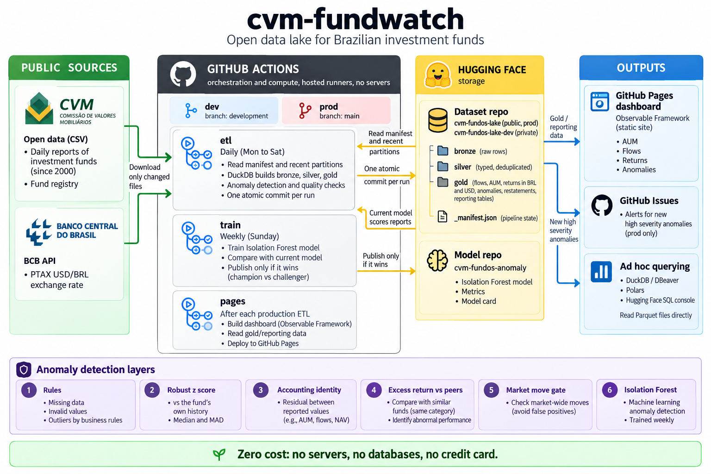

# cvm-fundwatch

A zero cost data pipeline for Brazilian investment fund data. It runs entirely on GitHub
Actions, builds a bronze/silver/gold lake of Parquet files on Hugging Face, detects anomalies in
the daily fund reports, and publishes a static dashboard on GitHub Pages.

- **Sources**: CVM daily reports of every investment fund since 2000 (today about 25,000
  classes and 500,000 rows a month), the CVM fund registry, and the BCB PTAX dollar rate.
- **Lake**: Parquet on a Hugging Face dataset repo, one atomic commit per run, queryable from the
  Hugging Face Data Studio, DuckDB, DBeaver or Polars.
- **Anomaly detection**: rules, robust statistics, an accounting identity check, peer context
  and an Isolation Forest, evaluated with injected errors. Market wide moves are not flagged.
- **Dashboard**: [dbconsultoria.github.io/cvm-fundwatch](https://dbconsultoria.github.io/cvm-fundwatch/)
- **Data**: [huggingface.co/datasets/dbconsultoria/cvm-fundos-lake](https://huggingface.co/datasets/dbconsultoria/cvm-fundos-lake)

No servers, no databases, no credit card.

## Architecture



Every run: read the state (`_manifest.json`) and the partitions of its window from Hugging Face,
download only source files that changed, rebuild the layers in DuckDB inside the runner, run
quality checks, and push everything in one commit. A failed check publishes nothing. Details,
Mermaid diagrams and the code map: [docs/architecture.md](docs/architecture.md).

| Layer | Tables | Grain |
|---|---|---|
| bronze | `cvm_inf_diario`, `cvm_registry/<table>`, `bcb_ptax` | source rows as strings, plus source metadata |
| silver | `fund_daily`, `fund_registry`, `ptax_daily` | typed, one schema across the three CVM layouts, deduplicated |
| gold | `daily_flows`, `returns_brl_usd`, `anomalies`, `restatements` | business tables, partitioned `ano_mes=YYYYMM` |
| gold | `reporting/*` | small aggregates for the dashboard |

| Workflow | When | What |
|---|---|---|
| `ci.yml` | push, pull request | ruff, the offline test suite, dashboard build from demo data |
| `etl.yml` | Mon to Sat 17:23 UTC, manual | pipeline for dev and prod; 13 month lookback on Saturdays |
| `train.yml` | Sundays 06:17 UTC, manual | trains the Isolation Forest, publishes it only if it beats the current one |
| `pages.yml` | after each ETL on `main`, manual | builds and deploys the dashboard |
| `keepalive.yml` | monthly | keeps the schedules enabled |

## Run it on GitHub

Everything below is done once in the Hugging Face and GitHub web interfaces. `<owner>` is your
Hugging Face user or organization; `<github user>` is the GitHub account that owns the repo.
The steps follow the order of the first real setup of this project.

### 1. Hugging Face: account, repos and tokens

1. Create a free account at huggingface.co (no credit card). Your username is `<owner>`.
2. Create four repositories (top right **+ New**, then **Dataset** or **Model**). The names are
   fixed by `config/pipeline.yml`, and the **type matters**: the anomaly repos are Models, not
   Datasets. The pipeline refuses to run if a visibility is wrong.

   | Repository | Type | Visibility |
   |---|---|---|
   | `<owner>/cvm-fundos-lake-dev` | Dataset | private |
   | `<owner>/cvm-fundos-lake` | Dataset | public |
   | `<owner>/cvm-fundos-anomaly-dev` | Model | private |
   | `<owner>/cvm-fundos-anomaly` | Model | public |

   A repo created with the wrong type cannot be converted: delete it (repo Settings, Delete) and
   create it again.

3. Create the tokens (avatar, **Settings, Access Tokens, Create new token**, tab
   **Fine-grained**). Under "Repositories permissions" search each repo, add it and tick
   **Write access to contents/settings of selected repos**. Read access alone is not enough:
   the run builds everything and then fails at the upload with
   `403 Forbidden ... xet-write-token`.

   Two ways to organize them:

   | Option | Tokens | Trade off |
   |---|---|---|
   | one token | write on all four repos | simplest; the dev job, which runs unreviewed code from `development`, also holds a token that can write prod |
   | per environment (recommended for teams) | `cvm-fundwatch-dev`: write on the two `-dev` repos; `cvm-fundwatch-prod`: write on the two prod repos | prod credentials never reach the dev job |

   A token value is shown **once**. Copy it straight into the GitHub secret (step 2). If you
   lose it, use **Invalidate and refresh** on the token: same name and permissions, new value;
   then update the GitHub secrets. Never paste a token into `.env.example` or any tracked file.

### 2. GitHub: repository settings

The repository must be **public**: on the free plan, Environments and their secrets are not
available for private repositories, and Actions minutes are unlimited only for public ones.

1. **Settings, Actions, General**, Workflow permissions: "Read repository contents and packages
   permissions". Leave "Allow GitHub Actions to create and approve pull requests" unticked.
2. **Settings, Secrets and variables, Actions**, tab **Variables**: repository variable
   `HF_OWNER` = `<owner>`. It must be a repository variable (not only an environment one):
   the dev, prod and pages jobs all read it.
3. **Settings, Pages**, Build and deployment, Source: **GitHub Actions** (not "Deploy from a
   branch"). Pages is set per repository, so other Pages sites of the same account are not
   affected; this one is served at `https://<github user>.github.io/cvm-fundwatch/`. A custom
   domain is optional and not needed.
4. **Settings, Environments**, create three environments:

   | Environment | Deployment branches | Required reviewers | Secrets | Variables |
   |---|---|---|---|---|
   | `dev` | selected: `main`, `development` | none | `HF_TOKEN`, `HF_MODEL_TOKEN` | `CVM_LAKE_ENV` = `dev` |
   | `prod` | selected: `main` | none | `HF_TOKEN`, `HF_MODEL_TOKEN` | `CVM_LAKE_ENV` = `prod` |
   | `prod-approval` | selected: `main` | yourself (optional) | none | none |

   - `HF_TOKEN` writes the dataset, `HF_MODEL_TOKEN` writes the model repo and reads the
     dataset. With the one token option both secrets hold the same value.
   - `CVM_LAKE_ENV` goes under **Environment variables**, not secrets. If it is missing or
     stored as a secret, the run stops with
     `guard: GitHub Environment declares CVM_LAKE_ENV='', run asked for 'prod'`.
   - `dev` allows `main` because scheduled workflows always start from the default branch; the
     dev job then checks out `development`.
   - `prod-approval` is the gate for manual writes to prod. Without a reviewer the gate passes
     on its own, which is fine for a personal project: the code still refuses prod from any
     branch but `main`, and manual runs default to a dry run.
   - `github-pages` is created by GitHub on the first deployment and needs nothing.

### 3. Push the code

Once step 2 is done (otherwise the first scheduled runs fail at the guard):

```bash
git push -u origin main
git push origin main:development
```

Then **Settings, Rules, Rulesets**, a branch ruleset for `main`: require a pull request before
merging, require the status checks `test` and `dashboard` (they appear after the first CI run),
block force pushes, restrict deletions. Optionally a lighter one for `development` (require
`test`, block force pushes).

### 4. Running a workflow by hand

**Actions** tab, pick the workflow in the **left menu** (`etl`, `train`, `pages`; the list in
the middle only shows past runs), then **Run workflow** on the right:

| Input | Meaning |
|---|---|
| Use workflow from | the branch the workflow file is read from: `development` for dev, `main` for prod |
| environment | `dev` or `prod`; decides the lake, the tokens and the branch whose code runs |
| Build everything, publish nothing | the **dry run**. **Ticked by default.** Untick it to write to Hugging Face |
| months | a backfill range, e.g. `202501-202608`, at most 36 months. Empty: current and previous month |
| lookback | months back from today when `months` is empty. Usually empty |

The job page shows a summary: bronze status and rows per source, silver and gold checks,
anomalies per month and severity, and the quality checks. A dry run also uploads the built
files as the artifact `lake-<env>-<run id>` (kept 7 days). A real run ends with the Hugging
Face commit it made.

### 5. First dev runs

All with branch `development` and environment `dev`:

1. **Dry run** (box ticked, months empty). Checks the guard, the token, the repo visibility and
   that CVM and BCB answer from GitHub's runners. On an empty repo the log shows
   `No files matched allow_patterns`: expected, there is nothing to read yet.
2. **Real run** (box unticked). The dev dataset gets its first commit: `bronze/`, `silver/`,
   `gold/`, `_manifest.json` and a dataset card.
3. **Backfill**, e.g. `months` = `202501-202608`, box unticked. About 6 minutes for 20 months,
   committed in 12 month chunks.
4. **Recompute the latest months** (months empty, box unticked). The first runs had no history
   behind them, so most funds lacked the 30 prior reports the statistical layers need; this
   rebuilds them with history.
5. **Train** (workflow `train`, branch `development`, environment `dev`). Needs at least 10
   months: 6 training months, 3 history months and the evaluation month (by default the last
   complete month). The first model is published to `cvm-fundos-anomaly-dev`; from then on the
   ETL log no longer says `Isolation Forest layer off`.

### 6. Prod

1. Open a pull request from `development` to `main`; merge when CI is green (skip it when the
   branches are equal).
2. **etl**, branch `main`, environment `prod`: dry run first, then box unticked. The real run
   passes through `approve` (waiting for a reviewer if `prod-approval` has one) and makes the
   first prod commit.
3. **pages** starts after every ETL on `main`. Until the prod dataset has its first commit it
   fails at "Download the reporting tables" on purpose, rather than deploying an empty site.
   After the first real prod run it deploys the dashboard.
4. **Backfill prod oldest first**, one dispatch at a time, waiting for each to finish: the
   first month of a range reads the previous month's silver, published by the previous range.

   | # | months | notes |
   |---|---|---|
   | 1 | `200001-200212` | about 1 minute: 2000 and 2001 hold 6 and 5 funds; coverage starts in 2002 |
   | 2 | `200301-200512` | |
   | 3 | `200601-200812` | |
   | 4 | `200901-201112` | |
   | 5 | `201201-201412` | |
   | 6 | `201501-201712` | |
   | 7 | `201801-202012` | |
   | 8 | `202101-202312` | |
   | 9 | `202401-` up to the month before the latest run | the latest two months are already there |

   Runs get longer as the number of funds grows (today about 25,000 classes and 500,000 rows a
   month). Avoid having a range running at 17:23 UTC: the scheduled run queues behind it.
5. **Train prod** after range 9. Training reads the months right before the evaluation month,
   so it fails until those exist; a failed training publishes nothing and the forest layer
   stays off.

### 7. Day to day

Nothing to do. The ETL runs Monday to Saturday at 17:23 UTC (after the CVM refresh and the PTAX
publication) for both lakes, training on Sundays, the dashboard after each prod ETL. What to
look at:

| Signal | Meaning | Action |
|---|---|---|
| green run | published | none |
| yellow run (warnings) | a source was down, or a soft check warned | none; the next run catches up |
| red run, quality failed | a blocking check failed; nothing was published | read the step summary; rerun with dry run to inspect the artifact |
| red run, guard (exit 2) | a variable, secret or repo visibility is wrong | fix the setting named in the log |
| red run, `403 ... xet-write-token` | the token can read but not write the repo | give the token write access to that repo (step 1.3) |
| red run, commit failed | something else wrote to the repo during the run | rerun |
| red `pages` run before any prod commit | the prod dataset is still empty | none; it goes green after the first real prod run |
| skipped `pages` run | the ETL that triggered it was a dev run | none |
| Issue `[prod] High severity anomalies YYYY-MM` | new high findings (at most 20 per date) | read; details in `gold/anomalies` |
| schedule stopped | GitHub disables schedules after 60 days without activity | `keepalive` re-enables them monthly; or enable `etl` in the Actions tab |

A rerun of the same months is safe (idempotent). GitHub only shows run logs to signed in users,
even on a public repo.

## Run locally

Requires [uv](https://docs.astral.sh/uv/) (and Node 20+ for the dashboard).

```bash
uv sync
uv run pytest            # offline: network access is blocked in tests
uv run ruff check .
```

```bash
# current and previous month into data/lake (git ignored)
uv run cvm-lake run --env dev

# a backfill; months before 2021 come from the CVM yearly archives
uv run cvm-lake run --env dev --months 202301-202312

# rebuild silver, gold, anomalies and reporting from local bronze, no downloads
uv run cvm-lake run --env dev --months 202310 --no-extract

# against the dev Hugging Face repo, without publishing (reads HF_OWNER and HF_TOKEN from .env)
uv run --env-file .env cvm-lake run --env dev --target hf --out data/hf-dev --dry-run
```

For runs against Hugging Face, copy `.env.example` to `.env` (git ignored) and fill in
`HF_OWNER` and `HF_TOKEN` there. `.env.example` is tracked: keep its values empty.

The run prints a report per layer and exits with 1 when a blocking quality check fails.
`data/lake/_manifest.json` holds the state: unchanged source files are not downloaded again.

Dashboard: see [dashboard/README.md](dashboard/README.md).

## Query the lake

Every table of the public dataset can be queried without cloning anything.

**Hugging Face Data Studio** (SQL console): open `huggingface.co/datasets/<owner>/cvm-fundos-lake`,
pick a config (`daily_flows`, `returns_brl_usd`, `anomalies`, `restatements`, `fund_daily`,
`fund_registry`, `ptax_daily`) and query it in the browser.

**DuckDB**:

```sql
-- optional for the public lake (avoids anonymous rate limits), required for the dev lake
CREATE SECRET hf (TYPE huggingface, TOKEN 'hf_...');

-- assets under management per peer group on the last day of 2025
SELECT peer_group, round(sum(aum) / 1e9, 1) AS aum_brl_bn
FROM read_parquet('hf://datasets/<owner>/cvm-fundos-lake/gold/daily_flows/*/*.parquet',
                  hive_partitioning = true)
WHERE dt = DATE '2025-12-30' AND NOT coalesce(is_fic, false)
GROUP BY ALL ORDER BY 2 DESC;

-- high severity anomalies of a month
SELECT dt, fund_id, anomaly_type, score
FROM 'hf://datasets/<owner>/cvm-fundos-lake/gold/anomalies/ano_mes=202610/part-0.parquet'
WHERE severity = 'high' ORDER BY score DESC LIMIT 20;

-- a partition as it was at an earlier commit (commit ids are in _manifest.json)
SELECT count(*) FROM 'hf://datasets/<owner>/cvm-fundos-lake@<commit>/silver/fund_daily/ano_mes=202609/part-0.parquet';
```

**DBeaver** (or any DuckDB client): build a local DuckDB file with one view per table, then
open it as a DuckDB connection. The file holds view definitions only (no data, no token) and
is git ignored; rerun the script to pick up tables added since.

```bash
uv run python scripts/make_duckdb.py   # prod lake -> database/cvm_lake.duckdb
```

In DBeaver: New Database Connection, DuckDB, Path `database/cvm_lake.duckdb`. The schemas
`silver`, `gold` and `reporting` show up as tables. Filter by `ano_mes` on large views; every
query reads from Hugging Face. DuckDB allows one process per file: close the connection before
rerunning the script. For the private dev lake, run it with `HF_TOKEN` set and
`--env dev --out database/cvm_lake_dev.duckdb`, and create a secret once in the client:
`CREATE PERSISTENT SECRET hf (TYPE huggingface, TOKEN 'hf_...');`.

**Polars** (`pip install polars`; reads `HF_TOKEN` from the environment):

```python
import polars as pl

returns = pl.scan_parquet(
    "hf://datasets/<owner>/cvm-fundos-lake/gold/returns_brl_usd/**/*.parquet",
    hive_partitioning=True,
)
(
    returns.filter(pl.col("peer_group") == "Ações")
    .group_by("dt")
    .agg(pl.col("ret_brl").median(), pl.col("ret_usd").median())
    .sort("dt")
    .collect()
)
```

## Anomaly detection and experiments

Layers, anomaly types and severity, the calibration history and the evaluation method are in
[docs/anomaly_detection.md](docs/anomaly_detection.md). In short: rules plus robust z scores of
the fund's own returns, an accounting identity residual and the excess return over peers, all
silenced on market wide moves, plus an Isolation Forest for low severity leads. Without labels,
the detector is evaluated by injecting errors (decimal shifts, glitches, equity jumps, stale
quotas, ...) into a copy of the data; CI enforces recall floors on a synthetic panel. Restatements
published by CVM are kept as weak labels.

Reproducible experiments (fixed seeds, versioned configs, results with config hashes and the git
commit):

```bash
uv run cvm-lake evaluate --lake data/lake --months 202609,202610 \
  --experiment config/experiments/v1_baselines.yml --out experiments/results
```

## Costs

Zero, with no credit card on any account:

| Piece | Why it is free |
|---|---|
| GitHub Actions | standard hosted runners are free and unlimited for public repositories |
| GitHub Pages, Issues | free for public repositories |
| Hugging Face storage | public datasets and models are free; the private dev repos only hold a year or so (check your private storage quota) |
| Data | CVM and BCB open data, no keys |
| Compute | DuckDB, scikit-learn and Observable Framework run inside the runner |

The limits that matter are operational, not financial: a job runs at most 6 hours (ours are
capped at 2), scheduled workflows pause after 60 days without activity (`keepalive`), and the
Hugging Face Hub rate limits commits (one per run is far below it).

## What would change in a real enterprise

The design choices that would stay: medallion layers, idempotent partition rewrites, an explicit
pipeline state, quality gates that block publishing, environment separation with promotion by
pull request, and evaluating detectors by injecting known errors. What would change:

| Here | In an enterprise |
|---|---|
| Parquet files on a Hugging Face repo, `_manifest.json` as state | object storage (S3, ADLS, GCS) with a table format (Apache Iceberg or Delta Lake): ACID commits, time travel, schema evolution and partition evolution instead of a hand made manifest |
| repo commits as the only history | a catalog (Unity Catalog, AWS Glue, Polaris, Nessie) with lineage, ownership, access policies and discovery |
| GitHub Actions schedules | an orchestrator (Airflow, Dagster, Prefect) with backfills, retries per task, sensors on source updates, SLAs and a run history |
| DuckDB in a runner | DuckDB or Polars still works for this volume; at larger scale Spark, Trino or a warehouse (Snowflake, BigQuery, Databricks SQL) |
| fine grained tokens in GitHub secrets | short lived credentials via OIDC federation and a secrets manager; least privilege roles per job |
| quality checks in Python | a declared data contract per table and a quality framework (Great Expectations, Soda, dbt tests) with results stored and trended |
| Issue comments as alerts | routing to on call (PagerDuty, Opsgenie, Teams or Slack) with severity, ownership and acknowledgement |
| skops files in a model repo | a model registry (MLflow, SageMaker, Vertex) with stages, approvals and monitoring of drift and alarm rates |
| restatements as appended rows | change data capture from the provider, bitemporal tables (valid time and system time) |
| static dashboard | a governed BI layer (Power BI, Looker, Superset) on a semantic model, with row level security |
| one person owns everything | separate owners for ingestion, platform, models and consumers; incident and change management |

## Repository

| Path | Content |
|---|---|
| `src/cvm_lake/` | the pipeline (`cvm-lake` command) |
| `config/` | pipeline, anomaly thresholds, experiments |
| `dashboard/` | Observable Framework site |
| `tests/` | offline tests and fixtures |
| `scripts/make_duckdb.py` | DuckDB file with views over the lake, for DBeaver |
| `database/` | the generated DuckDB file (git ignored) |
| `.github/workflows/` | CI, ETL, training, Pages, keepalive |
| [docs/architecture.md](docs/architecture.md) | diagrams, run sequence, code map |
| [docs/sources.md](docs/sources.md) | what the source files really look like |
| [docs/decisions.md](docs/decisions.md) | 36 architecture decision records |
| [docs/anomaly_detection.md](docs/anomaly_detection.md) | detector, evaluation, calibration history |

## License

MIT, see [LICENSE](LICENSE). The data is republished from CVM and Banco Central do Brasil open
data; check their terms before reuse.
