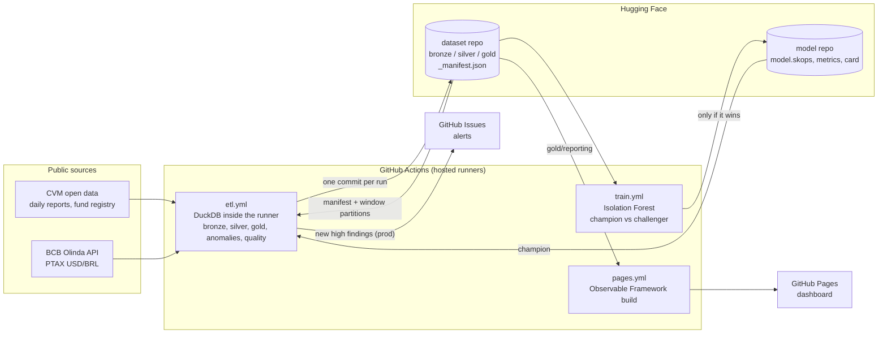
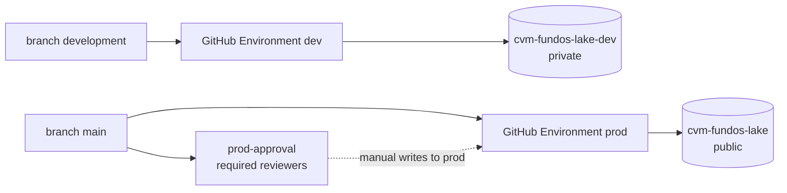
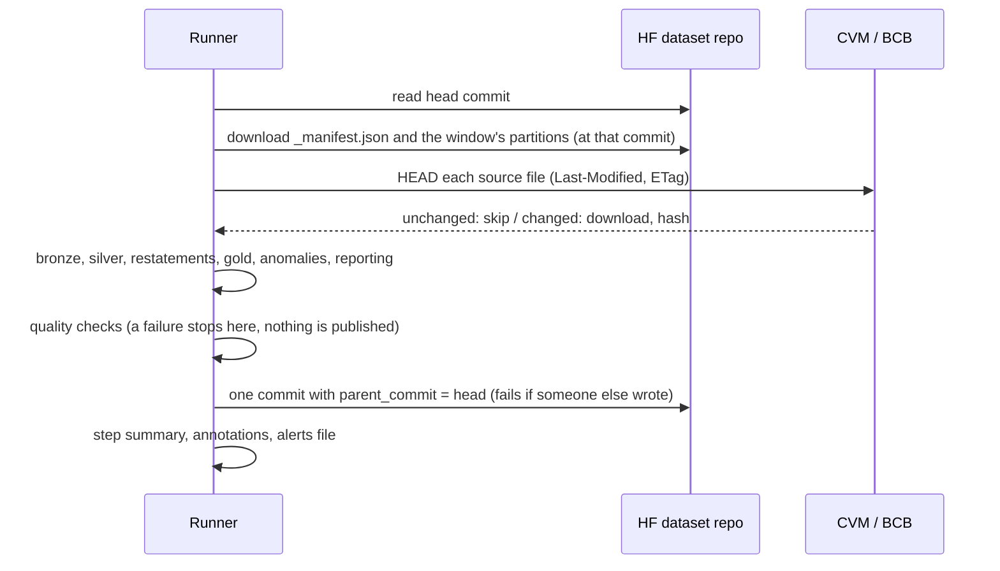

# Architecture

## Components

There is no server and no database. Compute is DuckDB in a GitHub hosted runner, storage is a
Hugging Face dataset repo (Parquet files plus `_manifest.json`, which is the pipeline state),
orchestration is GitHub Actions, and the dashboard is a static site.

## Environments

- Code is promoted by pull request from `development` to `main`.
- Each Environment holds its own tokens, scoped to its own repos, and declares `CVM_LAKE_ENV`.
  The guard refuses a run whose `--env`, branch, repo name, token or repo visibility do not
  match (ADR 0022).
- The schedule runs from the default branch, so one scheduled workflow serves both lakes: each
  job checks out the branch of its environment.

## One ETL run

- **Window**: current and previous month on weekdays, 13 months on Saturdays (CVM regenerates
  about a year of files every week). Backfills pass explicit months and are split into
  12 month chunks, one commit each.
- **Idempotent**: every partition is a fixed file name, rebuilt from its inputs. Rerunning a
  window gives the same files; bronze holds no run metadata (ADR 0012).
- **Incremental**: unchanged sources (same `Last-Modified`, or same hash) are not downloaded or
  rewritten. Silver and gold are rebuilt for the window because that is cheap.
- **Failure policy**: a source that is down is skipped with a warning (yellow run); a changed
  file format or a failed quality check fails the run (red) and publishes nothing (ADR 0015).

## Layers

| Layer | Content | Built from |
|---|---|---|
| bronze | source rows as strings, plus source URL, member, `Last-Modified`, SHA-256 | the source files |
| silver | typed, one schema for the three CVM layouts, deduplicated; class intervals for peer groups; one PTAX rate per day | bronze |
| gold | flows and AUM, returns in BRL and USD, anomalies, restatements | silver |
| gold/reporting | small aggregates for the dashboard, merged month by month | gold |

Layer details, decisions and their reasons: [decisions.md](decisions.md). Source formats:
[sources.md](sources.md). Anomaly detection: [anomaly_detection.md](anomaly_detection.md).

## Code map

| Path | Role |
|---|---|
| `src/cvm_lake/sources/` | parsing of each source (no network) |
| `src/cvm_lake/http.py` | downloads with retries and backoff |
| `src/cvm_lake/bronze.py`, `silver.py`, `gold.py`, `reporting.py` | the layers |
| `src/cvm_lake/anomalies/` | features, rules, detector, injection, evaluation, restatements, forest |
| `src/cvm_lake/quality.py` | checks that fail the run |
| `src/cvm_lake/pipeline.py` | one run, all layers |
| `src/cvm_lake/publish.py`, `store.py`, `guard.py` | Hugging Face target, one commit per run, environment guard |
| `src/cvm_lake/cli.py`, `modelops.py` | the `cvm-lake` command |
| `config/` | pipeline, anomaly thresholds, experiments |
| `dashboard/` | Observable Framework site and its Python data loaders |
| `tests/` | offline tests (network blocked), fixtures for every layout and anomaly type |
